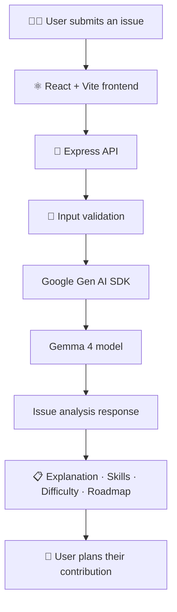

# 🌉 IssueBridge

<div align="center">


### From confusing issues to confident contributions.

**Your AI-powered bridge into open source.**

IssueBridge helps beginner contributors understand GitHub issues, discover relevant skills, estimate difficulty, and build a practical roadmap toward making their first contribution.

<br>

[](https://react.dev/)
[](https://vite.dev/)
[](https://nodejs.org/)
[](https://ai.google.dev/gemma)
[](LICENSE)

**Built for MLH Hacktoberfest Hack Day Pune × OSSC AIT · 17 October 2026**

[Explore the project](#-features) · [Get started](#-getting-started) · [Contribute](#-contributing)

</div>

---

## ✨ Why IssueBridge?

Open-source software is built by communities, but getting started can feel intimidating.

A GitHub issue may contain unfamiliar terminology, complex technical requirements, and an unclear starting point. Beginners can struggle to determine which skills they need, how difficult a task might be, or what to do first.

**IssueBridge turns an unfamiliar issue into a clearer starting point.**

It uses Google's Gemma 4 model through the Gemini API to analyse an issue description and present an approachable explanation, relevant skills, an estimated difficulty level, and a structured contribution roadmap.

Our goal is simple: make the first steps into open source less confusing and more accessible.

## 🚀 Features

<table>
<tr>
<td width="50%" valign="top">

### 🧠 Beginner-Friendly Explanations

Understand what an issue is asking for without getting lost in unfamiliar technical language.

</td>
<td width="50%" valign="top">

### 🛠️ Skill Discovery

Identify potentially relevant programming skills, tools, and concepts before starting.

</td>
</tr>
<tr>
<td width="50%" valign="top">

### 🎯 Difficulty Estimation

Get an AI-generated estimate of the issue's difficulty to help plan your next steps.

</td>
<td width="50%" valign="top">

### 🗺️ Contribution Roadmap

Break an intimidating task into smaller, more approachable steps.

</td>
</tr>
<tr>
<td width="50%" valign="top">

### 📝 Custom Issue Analysis

Submit your own issue description and receive a tailored analysis.

</td>
<td width="50%" valign="top">

### ⚡ Practical Developer Experience

A React-based interface backed by an Express API, with input validation and helpful error handling.

</td>
</tr>
</table>

*AI-generated explanations and estimates are suggestions, not guarantees.*

## 🔄 How It Works



The frontend sends an issue description to the backend. The backend validates the input and calls the configured Gemma model through Google's Gemini API. The resulting analysis is returned to the interface for the user to review.

## 🧠 AI Model & Implementation

<div align="center">

### Powered by Gemma 4

**Model:** `gemma-4-26b-a4b-it`

</div>

IssueBridge integrates Google's Gemma 4 model through the **Google Gen AI SDK** and Gemini API.

The model helps interpret issue descriptions and generate structured guidance intended to make open-source tasks easier to understand.

| Component | Role |
|---|---|
| Gemma 4 | Generates the issue analysis and contribution guidance |
| Google Gen AI SDK | Connects the backend to the model API |
| Express backend | Handles requests, validation, and model integration |
| React frontend | Presents the analysis to the user |

The application uses API-based inference. It does not claim to train or fine-tune the model.

**Important:** Model responses can be inaccurate, incomplete, or overly confident. Always check the original issue, repository documentation, contribution guidelines, and maintainer feedback.

## 🏗️ Technology Stack

<div align="center">

| Layer | Technologies |
|---|---|
| Frontend | React, Vite, JavaScript |
| Backend | Node.js, Express |
| AI integration | Google Gen AI SDK |
| AI model | Gemma 4 — `gemma-4-26b-a4b-it` |
| Testing | Node.js test tooling, as configured in the repository |
| Licence | Apache-2.0 |

</div>

## 📁 Project Structure

```text
React + Vite browser --POST /api/analyze--> Express server --> Gemma 4 via Gemini API
        ^                                     | validate input and prompt
        └------ {ok, data, meta} <------------└ parse and validate model JSON
```

- [`server/src/services/gemma.js`](server/src/services/gemma.js) calls `@google/genai` 2.30.0 with `GoogleGenAI` and `ai.models.generateContent`.
- [`server/src/prompt.js`](server/src/prompt.js) defines the system instruction; [`server/src/validate.js`](server/src/validate.js) validates requests and model output.
- The server returns `{ ok, data, meta }`; see [`docs/planning/ARCHITECTURE.md`](docs/planning/ARCHITECTURE.md) for the API contract.
- No database, account system, GitHub API, or repository access is used.

## Verification status

- Backend automated tests: **21/21 passed** (`server`: `npm test`, including error distinction and custom issue regression tests).
- Client production build: **passed** (`client`: `npm run build`).
- Live end-to-end: verified with real model `gemma-4-26b-a4b-it` through `/api/analyze` and the browser UI for both built-in samples and custom GitHub issues. Transient upstream 5xx errors from the hosted provider are handled via automatic backoff retry and clear error reporting.
- Live error checks: malformed JSON, missing/empty/short input returned HTTP 400 `INVALID_INPUT`; an 8,001-character input returned HTTP 413 `INPUT_TOO_LONG`. A separate process using a dummy invalid credential returned HTTP 500 `SERVER_MISCONFIGURED` without echoing the credential. A 1 ms timeout returned HTTP 504 `UPSTREAM_TIMEOUT`. The rate-limit response is covered by a mocked route test (HTTP 429); no real quota was exhausted to induce it.
- Live edge inputs: a prompt-injection/HTML-containing issue returned schema-valid analysis; a Spanish issue returned valid analysis after one transient upstream failure. An unrelated paragraph returned `BAD_MODEL_OUTPUT` after the server's single retry, without crashing or leaking upstream details. The browser input checks disabled submission for empty, 19-character, and over-limit values and showed the over-limit message.
- Fresh local clone: overlaid the current working-tree changes onto a separate Git clone, then ran `npm ci`, server tests (21/21), and the client production build from that checkout with no original `node_modules` or build artifacts. Both documented dev servers started; health and frontend returned HTTP 200. The clone used a blank `.env` (the real key was not copied), so its `/analyze` correctly returned `SERVER_MISCONFIGURED`.
- A stopped backend displayed the network error while preserving the issue text. Retry succeeded after a transient upstream HTTP 500.
- Intermittent upstream Gemma 4 provider 5xx errors are handled via automatic backoff retry in `callGemma` and safe error propagation; both built-in samples and custom GitHub issues have been verified end-to-end with live inference.
- There is no automated browser-test suite in this repository; the browser flow was checked manually and with headless browser subagent verification.

## Windows setup

Requirements: Git, Node.js (tested with v24.12.0 and npm 11.6.2), and a Gemini API key from [Google AI Studio](https://aistudio.google.com/).

After cloning the repository, open PowerShell in its root folder:

```powershell
Copy-Item .env.example .env
```

**macOS/Linux:**

```bash
cp .env.example .env
```

Open `server/.env` and configure your API key and model:

```dotenv
GEMINI_API_KEY=your_google_ai_api_key
GEMMA_MODEL=gemma-4-26b-a4b-it
PORT=3001
```

Use these entries only if they match the variables supported by your existing `.env.example` and backend code. Preserve any other required configuration already present in that template.

Keep your real API key private. Never commit `.env` or expose the key in frontend code.

Start the backend in the `server` directory using the start script defined in `server/package.json`, for example:

```bash
npm start
```

### 3. Configure the frontend

Open a second terminal:

```bash
cd client
npm install
npm run dev
```

Vite will print the local frontend URL in the terminal, usually `http://localhost:5173`.

For local development, the frontend's API configuration may use the same origin when a proxy is configured. If the frontend needs to call the backend directly, set the supported `VITE_API_BASE_URL` variable to the backend's local URL.

For example:

```dotenv
VITE_API_BASE_URL=http://localhost:3001
```

Only use this variable if the frontend configuration and Vite setup support it. Restart the Vite development server after changing environment variables.

### 4. Start developing

Open the local frontend URL in your browser, enter a sample issue, and review the generated analysis.

If a request fails, check the backend terminal for provider errors, missing environment variables, invalid model configuration, or quota issues.

## 🔑 Environment Variables

The following table describes the expected configuration. Confirm each variable against the actual backend `.env.example` and frontend code before deployment.

| Name | Required | Default | Purpose |
|---|---|---|---|
| `GEMINI_API_KEY` | Yes | — | Google AI Studio key; server-only, never commit it. |
| `GEMMA_MODEL` | No | `gemma-4-26b-a4b-it` | Exact Gemma 4 model identifier. |
| `PORT` | No | `3001` | Express API port. |
| `CORS_ORIGIN` | No | `http://localhost:5173` | Allowed browser origin. |
| `MAX_INPUT_CHARS` | No | `8000` | Maximum issue text length. |
| `MODEL_TIMEOUT_MS` | No | `90000` | Per-model-call timeout; increased after a real request exceeded the previous 30-second limit. |
| `THINKING_LEVEL` | No | `minimal` | Verified Gemma 4 setting. |
| `JSON_MODE` | No | `true` | Requests `application/json`; verified with this model. |

## Tests and checks

Run these commands from the relevant directories.

**Backend tests:**

```bash
cd server
npm test
```

**Frontend production build:**

```bash
cd client
npm run build
```

The project's development verification previously reported 21 passing backend tests and a successful Vite production build. Run the commands above to verify the current repository state.

## ☁️ Deployment

IssueBridge can be deployed as two separate services.

| Service | Suggested platform | Directory |
|---|---|---|
| Frontend | Vercel | `client/` |
| Backend | Render | `server/` |

### Frontend deployment

1. Import the GitHub repository into Vercel.
2. Set the root directory to `client`.
3. Use `npm run build` as the build command and `dist` as the output directory.
4. Set `VITE_API_BASE_URL` to the actual deployed backend URL.
5. Redeploy after changing environment variables.

### Backend deployment

1. Create a web service on Render connected to the GitHub repository.
2. Set the root directory to `server`.
3. Configure the build command using the project's package manager, such as `npm install`.
4. Configure the start command using the script defined in `server/package.json`.
5. Add the required backend environment variables in the hosting dashboard.
6. Ensure the server listens on the platform-provided `PORT` and allows requests from the deployed frontend origin.

After deployment, test the public website with a built-in sample and a custom issue.

**Deployment status:** A public production URL should be added here only after the deployment has succeeded and the live application has been tested.

## ⚠️ Limitations & Responsible Use

- AI-generated explanations may omit important technical context.
- Difficulty estimates are approximate and depend on the information in the issue.
- The model may suggest skills or steps that do not fully match a repository's architecture.
- API availability, latency, quotas, and configuration can affect response times.
- Always read the original issue and the repository's contribution guidelines before submitting a change.

IssueBridge is a guidance tool. It does not replace repository maintainers, official contribution instructions, or your own technical review.

## 🛣️ Roadmap

Potential directions for future development include:

- [ ] Improve analysis quality for complex and ambiguous issues.
- [ ] Expand the range of issue examples and testing scenarios.
- [ ] Improve error messages and user feedback.
- [ ] Add more guidance for repository-specific contribution workflows.
- [ ] Refine accessibility, responsive design, and the user experience.

These are potential improvements, not claims that the features have already been implemented.

## 🤝 Contributing

Contributions, feedback, and bug reports are welcome.

1. Fork the repository.
2. Create a feature branch:

   ```bash
   git checkout -b feat/your-improvement
   ```

3. Make a focused change.
4. Run relevant tests and the frontend build.
5. Commit your changes:

   ```bash
   git commit -m "Describe your improvement"
   ```

6. Push your branch and open a pull request with a clear description of the change.

Please review the existing repository instructions before contributing.

## 🏆 Hackathon Context

IssueBridge is being prepared for:

**MLH Hacktoberfest Hack Day Pune × OSSC AIT — 17 October 2026**

The project uses Google's Gemma 4 model through the Gemini API and aims to make open-source contribution more approachable for beginners.

The repository includes an Apache-2.0 licence. Please refer to the actual project source and event requirements for implementation and submission verification.

## 🧾 AI-Assistance Disclosure

Document AI coding assistance accurately according to the tools and workflows actually used to develop this project.

Do not claim that all code was written manually or that no AI coding tools were used unless that is demonstrably true. Preserve the project's existing disclosure if one is already present, and update this section to reflect the actual development process before submission.

## 📄 Licence

IssueBridge is distributed under the **Apache License 2.0**. See the [`LICENSE`](LICENSE) file for the full terms.

## 🙌 Acknowledgements

- [Google Gemma](https://ai.google.dev/gemma) for the model family used by this project.
- [Google Gen AI SDK](https://github.com/googleapis/js-genai) for the API integration library.
- [React](https://react.dev/), [Vite](https://vite.dev/), [Node.js](https://nodejs.org/), and [Express](https://expressjs.com/) for the application stack.
- The open-source community for making software collaboration possible.

---

<div align="center">

### 🌉 Make the first contribution less intimidating.

**Understand the issue. Learn what you need. Take the next step.**

<sub>IssueBridge · Built for open source · Powered by Gemma 4</sub>

</div>

